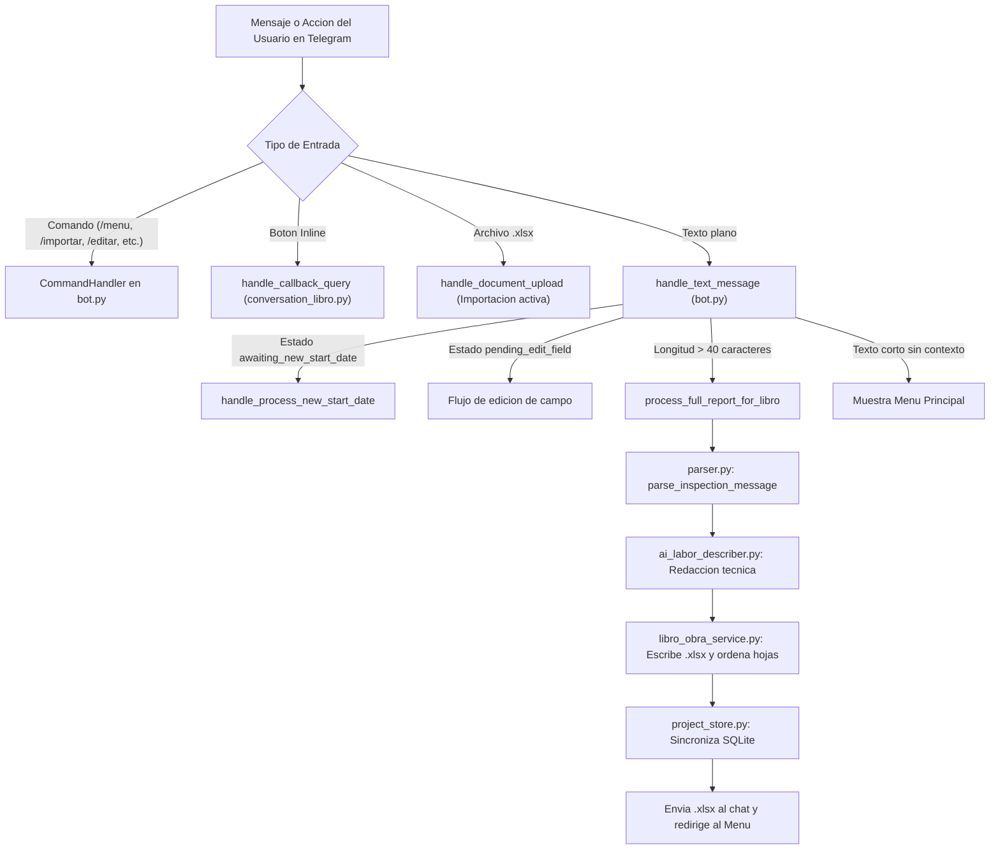
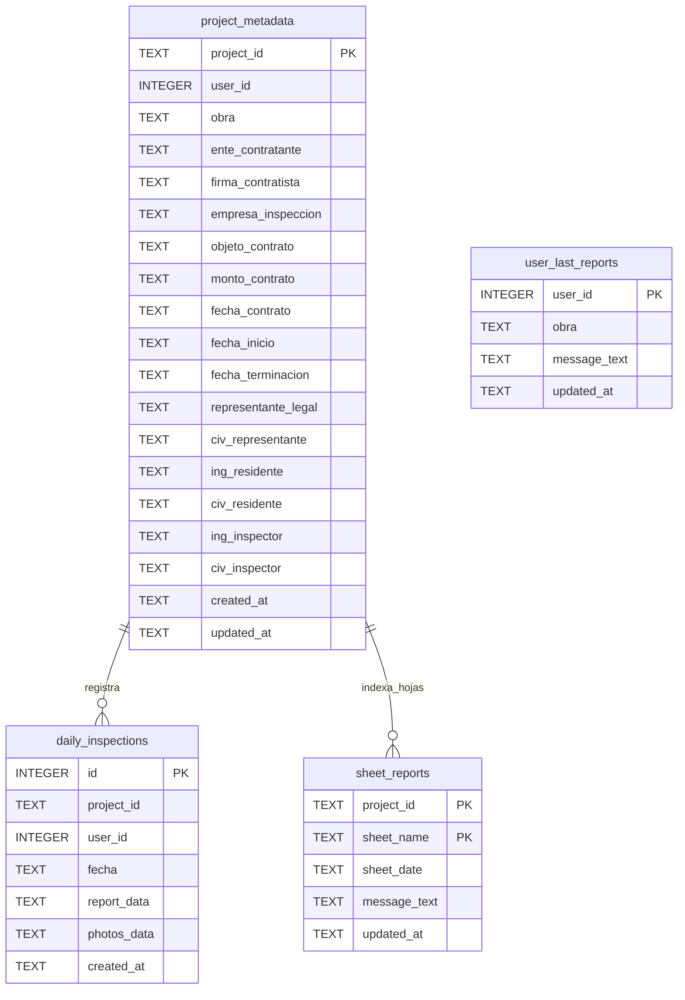

# Documentación Técnica y Funcional — Bot de Libro de Obra Digital (`libro_obra_bot`)

> **Paquete:** `libro_obra_bot` (*"Paquete del Bot exclusivo para Libro de Obra Digital"*)  
> **Punto de entrada:** `run_libro_bot.py` → `libro_obra_bot.bot.main()`  
> **Formato estándar:** Libro de Obra oficial conforme a la **Página 15 del Colegio de Ingenieros de Venezuela (CIV)** en formato Excel (`.xlsx`).

---

## 1. Propósito y Alcance

`libro_obra_bot` es un bot de Telegram diseñado para ingenieros inspectores e ingenieros residentes, enfocado exclusivamente en el registro, edición, reorganización cronológica, importación y descarga de **Libros de Obra Digitales** en formato Excel (`.xlsx`).

### Diferencias frente al bot heredado (`inspector_bot`)
- **Sin fichas PDF ni fotografías:** El formato legal del Libro de Obra del CIV no incluye registro fotográfico. Si el usuario envía una foto durante el flujo guiado, el manejador `cancel_libro_obra_photo` la rechaza e informa que el Libro de Obra oficial solo admite asientos escritos.
- **Autoguardado inmediato:** Al enviar o completar un reporte diario, el bot procesa, escribe el archivo `.xlsx`, sincroniza la base de datos SQLite, entrega el documento actualizado en Telegram y redirige al menú principal sin pasos de confirmación redundantes.
- **Edición fiel por hoja y fecha:** Cada hoja diaria almacena su mensaje fuente en SQLite (`sheet_reports`), permitiendo recuperarlo en texto plano para corregirlo y reenviarlo.

---

## 2. Arquitectura y Mapa de Archivos

```text
apupro_platform/
├── run_libro_bot.py                  # Lanzador principal (agrega BASE_DIR al sys.path y llama bot.main())
├── requirements_inspector.txt        # Dependencias Python del bot
└── libro_obra_bot/
    ├── __init__.py                   # Definición del paquete
    ├── config.py                     # Carga de .env, tokens, claves API y rutas de datos
    ├── bot.py                        # Inicialización de Telegram Bot, comandos, handlers y polling
    ├── keyboards.py                  # Teclados inline (menú principal y confirmaciones) y sanitización de nombres
    ├── conversation_libro.py         # Lógica conversacional, menús interactivos, importación y entrega
    ├── parser.py                     # Extractor de campos desde texto libre / semi-estructurado
    ├── ai_labor_describer.py         # Redacción técnica de la Labor Diaria con Gemini + respaldo heurístico
    ├── flow_cleanup.py               # Limpieza de mensajes: un solo panel de texto por chat
    ├── libro_obra_service.py         # Motor Excel (openpyxl): plantilla, celdas, fechas, fusión, importación y backups
    ├── project_store.py              # Capa SQLite (inspector_bot.db): obras, inspecciones y reportes por hoja
    ├── google_drive_service.py       # Integración opcional con Google Drive API / Sheets
    ├── DOCUMENTACION.md              # Este documento
    └── data/                         # Directorio de datos persistentes (en producción, symlink compartido)
        ├── plantilla_libro_obra.xlsx # Plantilla oficial base del Libro de Obra CIV
        ├── inspector_bot.db          # Base de datos SQLite
        ├── libros_de_obra/           # Archivos .xlsx generados por proyecto
        ├── backups/                  # Respaldos automáticos (preshift, premerge, preimport)
        └── photos/                   # Directorio creado por config.py (sin uso activo en Libro de Obra)
```

### Prioridad de Manejadores (`create_bot_app` en `libro_obra_bot/bot.py`)

El bot evalúa los mensajes entrantes en el siguiente orden estricto:

1. **Comandos directos** (`CommandHandler`): `/start`, `/menu`, `/ayuda`, `/help`, `/asentar`, `/nuevo`, `/libros`, `/ver`, `/editar`, `/recuperar`, `/recuperar_mensaje`, `/mensaje`, `/fecha_inicio`, `/modificar_fecha_inicio`, `/borrar_libro`, `/importar`, `/cancelar`.
2. **Conversación guiada** (`get_libro_obra_conversation_handler()`): Flujo paso a paso iniciado con `/llenar_libro` o el botón `✍️ Asentar Nueva Hoja Diaria`.
3. **Callbacks de botones inline** (`CallbackQueryHandler(handle_callback_query)`): Navegación por menús, descarga, edición, corrimiento de fecha, fusión, importación y eliminación.
4. **Recepción de documentos** (`MessageHandler(filters.Document.ALL, handle_document_upload)`): Procesa archivos `.xlsx` únicamente cuando el usuario ha activado el flujo de importación.
5. **Texto libre** (`MessageHandler(filters.TEXT & ~filters.COMMAND, handle_text_message)`): Enruta entradas de nueva fecha de inicio, ediciones pendientes o reportes completos pegados directamente (`len(text) > 40`).



---

## 2.1. Flujo visual limpio

`flow_cleanup.py` mantiene la conversación sin acumular mensajes:

- **Mensaje del usuario:** se elimina al recibirlo mediante `cleanup_user_message` (TypeHandler en grupo `-100`).
- **Panel del bot:** `CleanBot` reemplaza el panel de texto anterior al enviar uno nuevo.
- **Menú principal:** cuando se pulsa un botón inline, `return_to_clean_main_menu` edita el mismo mensaje con `edit_text` en lugar de borrarlo y crear otro.
- **Documentos:** los `.xlsx` descargados no se borran automáticamente para que el usuario pueda abrirlos.

Limitaciones:

- Telegram solo permite borrar mensajes propios o mensajes de usuario en chats privados; en grupos el bot necesita permisos de administrador.
- La edición puede fallar si el mensaje tiene más de 48 horas o si es un documento/foto.
- El tracking del último panel vive en memoria; tras reiniciar el bot se vuelve a crear un panel nuevo.

---


## 2.2. Compartición por libro

Cada libro tiene miembros independientes. Un usuario no ve libros de los que no
es miembro.

Tablas nuevas:

```text
project_members (project_id, user_id, role, invited_by, created_at)
project_invites (code, project_id, role, created_by, expires_at, used_by, used_at)
```

Roles:

```text
owner    → creador del libro; puede compartir, editar y eliminar
editor   → residente o inspector invitado; puede leer y editar
```

Límite:

```text
Máximo 2 usuarios activos por libro: 1 owner + 1 editor.
Solo el owner invita.
Solo puede existir una invitación pendiente.
Al revocar al inspector se libera el cupo.
```

Concurrencia:

```text
project_locks
- project_id
- user_id
- acquired_at
- expires_at
```

Mientras un usuario edita una obra, otro recibe:

```text
🔒 Libro en edición por otro usuario.
```

El bloqueo vence a los 30 minutos y se libera al guardar o cancelar.

Flujo:

```text
Menú → 👥 Compartir Libro
→ seleccionar libro
→ generar enlace / código temporal
→ el inspector abre el enlace
→ /start join_<código>
→ queda agregado como editor
```

El enlace es de un solo uso y vence en 7 días. El residente y el inspector
pueden leer y editar las hojas. Solo el owner puede eliminar el libro.

---


## 3. Guía de Uso: Comandos y Menú Principal

### Comandos Disponibles

| Comando | Acción |
| :--- | :--- |
| `/start`, `/menu` | Muestra la bienvenida y el menú principal con botones inline. |
| `/ayuda`, `/help` | Presenta la guía rápida de uso y formato de reporte recomendado. |
| `/asentar`, `/nuevo`, `/llenar_libro` | Inicia el asistente guiado paso a paso para registrar una nueva hoja diaria. |
| `/libros`, `/ver` | Lista los libros guardados para consultarlos o descargar su `.xlsx`. |
| `/editar`, `/recuperar`, `/recuperar_mensaje`, `/mensaje` | Abre el selector de libro y hojas guardadas para recuperar un reporte en texto plano y editarlo. |
| `/fecha_inicio`, `/modificar_fecha_inicio` | Inicia el ajuste masivo de la fecha de inicio de una obra sin crear hojas nuevas. |
| `/importar` | Activa el modo de recepción de archivo `.xlsx` para importar/actualizar un libro completo. |
| `/borrar_libro` | Abre el menú de eliminación definitiva de un libro y sus metadatos. |
| `/cancelar` | Cancela cualquier operación o conversación activa y limpia el estado del usuario. |

### Distribución del Menú Principal (`get_libro_main_keyboard`)

| Fila | Botón(es) | Callback ID |
| :---: | :--- | :--- |
| **1** | `✍️ Asentar Nueva Hoja Diaria` | `btn_libro_registrar` |
| **2** | `✏️ Editar una Hoja Guardada` \| `🔀 Fusionar Días` | `btn_libro_menu_editar` \| `btn_libro_menu_fusionar` |
| **3** | `📅 Modificar Fecha de Inicio` \| `📥 Importar Libro (.xlsx)` | `btn_libro_modificar_fecha_inicio` \| `btn_libro_menu_importar` |
| **4** | `📚 Ver / Descargar Libros` \| `🗑️ Eliminar un Libro` | `btn_libro_ver` \| `btn_libro_eliminar` |
| **5** | `ℹ️ Ayuda e Instrucciones` | `btn_libro_ayuda` |

---

## 4. Flujos de Registro de Hojas Diarias

### A. Flujo Rápido (Pegado directo de reporte)
Es la vía más ágil para asentar o actualizar una jornada diaria:

1. El usuario pega un reporte estructurado de más de 40 caracteres en el chat.
2. `handle_text_message` (y `is_full_inspection_report`, que exige `len > 40` y al menos 2 palabras clave reconocibles) detecta el reporte y llama a `process_full_report_for_libro`.
3. `parse_inspection_message` extrae todos los campos del texto.
4. `ai_labor_describer.generate_labor_description_ai` redacta el párrafo técnico oficial de la *Descripción de la Labor Diaria*.
5. `save_and_deliver_libro_entry` invoca `add_daily_entry_to_book`:
   - Si el libro no existe, se crea a partir de `plantilla_libro_obra.xlsx` y registra los datos en `DATOS GENERALES`.
   - Si ya existe una hoja con la misma `fecha`, actualiza esa hoja sin agregar un folio duplicado.
   - Si el libro es nuevo y la hoja `"1"` está en blanco, reutiliza la hoja `"1"`.
   - Si es una fecha nueva, crea la hoja siguiente y reordena las hojas diarias cronológicamente (`sort_sheets_by_date`).
6. Guarda el texto original en `sheet_reports` y `user_last_reports` (SQLite), intenta respaldo opcional en Drive, envía el archivo `.xlsx` actualizado por Telegram y muestra el menú principal.

**Ejemplo ilustrativo de mensaje para pegado directo** *(campos reconocidos por `parser.py`)*:

```text
Fecha: 22/10/2026
Obra: Rehabilitación de Vialidad Sector Centro
Empresa: Constructora Ejemplo C.A.
Ing. Residente: Juan Pérez (CIV 123456)
Ing. Inspector: Pablo Milano (CIV 654321)
Maestro de Obra: Carlos Gómez
Caporal: 1
Obreros: 12
Maquinarias y Equipos: Retroexcavadora CAT 416F, Compactadora de rodillo
Actividades:
- Excavación de zanjas para drenaje pluvial.
- Compactación de sub-base granular en tramo progresiva 0+100 a 0+250.
Control de Calidad / Ensayos: Toma de cilindros de concreto y ensayo Proctor modificado.
Clima: Soleado
Horas Trabajadas: 8 horas
Observaciones: Trabajos ejecutados conforme a especificaciones técnicas.
```

### B. Flujo Guiado Paso a Paso (`ConversationHandler`)
Se activa con `/llenar_libro`, `/asentar`, `/nuevo` o pulsando `✍️ Asentar Nueva Hoja Diaria`:

- Configurado con **10 estados conversacionales** (desde `STATE_SELECT_OBRA` hasta `STATE_OBSERVACIONES`, además de `STATE_CONFIRMAR_BORRADO`) y un tiempo de espera (`conversation_timeout`) de **900 segundos (15 minutos)**.
- Permite seleccionar una obra existente o crear una nueva ingresando los datos contractuales para `DATOS GENERALES`, y luego solicita los datos diarios (fecha, personal de obra/inspección, maquinarias, actividades, observaciones, clima, horas, ensayos/control de calidad).
- Al completar `STATE_OBSERVACIONES`, ejecuta automáticamente `save_and_deliver_libro_entry` sin requerir un botón adicional de confirmación.
- Si el usuario envía una foto durante la conversación, `cancel_libro_obra_photo` recuerda que el Libro de Obra no lleva imágenes y cancela la operación.

---

## 5. Funcionalidades Avanzadas de Gestión del Libro

### 1. ✏️ Editar una Hoja Guardada
- **Manejadores:** `handle_menu_editar_hoja`, `_show_sheets_for_book`, `handle_select_sheet_to_edit`.
- **Funcionamiento:**
  1. El bot lista los libros disponibles en `data/libros_de_obra/`.
  2. Al elegir un libro, muestra las hojas diarias numeradas (`1`, `2`, `3`...) con su fecha (`list_book_sheets`). Si el libro supera **10 hojas**, la botonera se organiza automáticamente en un diseño compacto de **2 columnas**.
  3. Al pulsar una hoja, busca el texto exacto guardado previamente en la tabla `sheet_reports` (por `(project_id, sheet_name)` o por fecha). Si el libro fue creado externamente o no tenía historial en `sheet_reports`, reconstruye el mensaje en texto plano leyendo las celdas reales del Excel mediante `load_sheet_entry_data` y `build_message_text_from_sheet_data`.
  4. Envía el reporte dentro de un bloque copiable de código (formato `text`). El usuario lo copia, modifica lo que necesite (conservando la obra y la fecha) y lo reenvía al chat; el bot actualiza la hoja correspondiente en el `.xlsx` y en SQLite.

### 2. 📅 Modificar Fecha de Inicio
- **Manejadores:** `handle_menu_modificar_fecha_inicio`, `handle_process_new_start_date`, `execute_confirm_shift_date`.
- **Servicios:** `calculate_start_date_shift_preview`, `apply_start_date_shift` (`libro_obra_service.py`), `update_sheet_reports_dates` (`project_store.py`).
- **Funcionamiento:**
  1. Permite corregir la fecha de inicio oficial de un proyecto cuando toda la cronología del libro debe adelantarse o atrasarse.
  2. **No agrega ni elimina hojas:** calcula el desplazamiento manteniendo los intervalos en **días hábiles** respecto a la fecha de inicio original, preservando intacto el contenido técnico de todas las hojas existentes.
  3. Muestra una previsualización previa con el cambio de fechas y solicita confirmación mediante `get_confirm_shift_date_keyboard()` (o cancelar con `get_cancel_shift_date_keyboard()`).
  4. Al confirmar, crea un respaldo preventivo `preshift` en `data/backups/`, actualiza la celda `G1` de cada hoja diaria, actualiza `DATOS GENERALES!G21` y `ACTAS!F6`, y sincroniza `sheet_reports` y `project_metadata` en SQLite.
  5. Si al adelantar la fecha de inicio quedan días contiguos que deban consolidarse, el usuario puede utilizar **🔀 Fusionar Días**.

### 3. 🔀 Fusionar Días
- **Manejadores:** `handle_menu_fusionar_dias`, `handle_select_pair_to_merge`, `execute_confirm_merge_sheets`.
- **Servicios:** `merge_daily_sheets` (`libro_obra_service.py`), `sync_sheet_reports_after_restructure` (`project_store.py`).
- **Funcionamiento:**
  1. Pensada para consolidar dos hojas diarias contiguas en una sola jornada (por ejemplo, tras adelantar la fecha de inicio o unificar actividades de un mismo día).
  2. El usuario elige el libro y selecciona el par de hojas a fusionar; el bot pide confirmación mediante `get_confirm_merge_keyboard(sheet1, sheet2)`.
  3. Antes de modificar, crea un respaldo preventivo `premerge` en `data/backups/`.
  4. Combina actividades por partida, maquinaria y equipos, observaciones y descripciones de labor diaria en la primera hoja.
  5. Elimina la segunda hoja, refolia todas las hojas diarias restantes en orden correlativo `1 .. N-1` (utilizando nombres temporales `__temp_merge_{i}__` para evitar colisiones de nombres en `openpyxl`), y reindexa `sheet_reports` mediante `sync_sheet_reports_after_restructure`.

### 4. 📥 Importar Libro (`.xlsx`)
- **Manejadores:** `handle_menu_importar_libro`, `handle_document_upload`, `handle_cancel_import`.
- **Servicio:** `import_and_sync_project_book` (`libro_obra_service.py`).
- **Funcionamiento:**
  1. Activado explícitamente desde el botón `📥 Importar Libro (.xlsx)` o el comando `/importar` (con botón cancelar `get_cancel_import_keyboard()`). De esta forma, ningún documento enviado accidentalmente fuera de flujo sobrescribe libros existentes.
  2. El bot valida que el documento adjunto tenga extensión `.xlsx`, posea la hoja `DATOS GENERALES`, incluya un nombre de obra identificable y contenga hojas diarias numeradas válidas.
  3. Si ya existía un libro para esa obra en `data/libros_de_obra/`, guarda una copia de seguridad `preimport` en `data/backups/`.
  4. Reemplaza el libro canónico (`{sanitize_filename(project_name)[:80]}_Libro_de_Obra.xlsx`), ordena cronológicamente las hojas diarias (`sort_sheets_by_date`), extrae los datos generales (`extract_general_data_from_workbook`) y reconstruye todos los mensajes editables en `sheet_reports` y los metadatos en `project_metadata` para que la edición por Telegram siga 100 % sincronizada con el Excel editado manualmente.

### 5. 📚 Ver / Descargar y 🗑️ Eliminar Libros
- **Ver / Descargar (`show_saved_libros_menu`, `handle_download_libro`):** Lista todos los `.xlsx` existentes y envía el archivo solicitado directamente al chat de Telegram.
- **Eliminar (`show_delete_libro_menu`, `ask_confirm_delete_libro`, `execute_delete_libro`):** Solicita confirmación explícita antes de borrar el archivo `.xlsx` y sus metadatos asociados mediante `delete_project_metadata`.

---

## 6. Motor de Parseo Inteligente (`libro_obra_bot/parser.py`)

El módulo `parse_inspection_message(text)` interpreta mensajes escritos en formato libre o con etiquetas tipo WhatsApp/Telegram y genera un diccionario normalizado con las siguientes claves:

`fecha`, `fecha_inicio`, `lapso_ejecucion`, `obra`, `empresa`, `ing_residente`, `civ_residente`, `ing_inspectores`, `ing_inspector`, `civ_inspector`, `maestro_obra`, `caporal`, `actividades`, `obreros`, `caporal_obra`, `clima`, `horas_trabajadas`, `personal_obra`, `equipos`, `observaciones`, `control_calidad`, `ensayos`, `revisado_por`, `raw_text`.

### Reglas y Protecciones Integradas
- **Normalización de fechas (`normalize_date_string`, `extract_date_from_text`):** Reconoce expresiones como `hoy`, `ayer`, `DD/MM/YYYY` y fechas textuales como `DD de mes de YYYY`.
- **Títulos profesionales (`format_engineer_name`):** Antepone automáticamente el prefijo `Ing.` a los nombres de ingenieros, pero respeta intactos títulos de personal de campo (`Maestro`, `Caporal`, `Obrero`, `Técnico`, `Albañil`).
- **Inspector Unipersonal (`resolve_single_inspector`):** De acuerdo con la normativa del Libro de Obra CIV, la firma de inspección corresponde a un ingeniero inspector responsable; si se detectan múltiples nombres o ya hay historial en el proyecto, prioriza a `"Pablo Milano"`.
- **Separación de roles (Inspección vs. Obra):** Filtra menciones de `Maestro de Obra` y `Caporal` para evitar que ingresen al cuadro de *Personal de Inspección* (`A8`), reubicándolos en *Movimiento de Personal* (`A3`). Asimismo, protege los nombres frente a conteos numéricos en las líneas de maestro/caporal.
- **Continuación multilínea:** Soporta listas o párrafos de varias líneas bajo los encabezados de `equipos`, `observaciones`, `actividades` e `ing_inspectores`.
- **Limpieza de actividades:** Remueve frases de condiciones climáticas que el usuario haya mezclado dentro de `actividades`, preservando el clima exclusivamente para su campo correspondiente.

---

## 7. Redacción Técnica con IA (`libro_obra_bot/ai_labor_describer.py`)

La celda central de **Descripción de la Labor Diaria** (`D3:F15`) es redactada por `generate_labor_description_ai`:

1. **Limpieza previa:** Sanitiza entradas mediante `_clean_activity_text`, `_clean_equipment_text` y `_clean_ensayos_text`.
2. **Modelo Gemini (`gemini-1.5-flash`):** Si existe la variable de entorno `GEMINI_API_KEY`, utiliza `google.generativeai` con instrucciones estrictas:
   - Redactar **un solo párrafo técnico de ingeniería civil** de entre **70 y 140 palabras**.
   - Integrar de forma coherente las actividades ejecutadas, la maquinaria/equipos empleados y los ensayos o controles de calidad (`ensayos`).
   - **Prohibiciones estrictas:** No mencionar condiciones climáticas y no inventar partidas, mediciones ni materiales que no figuren en el reporte del usuario.
3. **Respaldo determinista (`_heuristic_generate_civil_description`):** Si `GEMINI_API_KEY` no está configurada o la llamada a la API falla, construye automáticamente un párrafo técnico estructurado sin bloquear el guardado del libro.

---

## 8. Estructura Oficial del Libro en Excel (`libro_obra_bot/libro_obra_service.py`)

Los archivos se almacenan en `data/libros_de_obra/` con el patrón `{sanitize_filename(project_name)[:80]}_Libro_de_Obra.xlsx`, generados desde `data/plantilla_libro_obra.xlsx` (con detección y migración de plantillas heredadas mediante `is_workbook_outdated_layout`).

### Estructura de Pestañas
- Pestañas fijas a la izquierda: `"DATOS GENERALES"` y `"ACTAS"`.
- Hojas diarias a la derecha: numeradas secuencialmente `"1"`, `"2"`, `"3"`, ..., ordenadas cronológicamente por `sort_sheets_by_date`.

### Mapa de Celdas — Pestaña `DATOS GENERALES` y `ACTAS`

| Pestaña | Celda | Campo / Dato | Notas |
| :--- | :---: | :--- | :--- |
| `DATOS GENERALES` | `B4` | Nombre de la Obra (`obra`) | `load_sheet_entry_data` también lee respaldo en `D18`–`D26`. |
| `DATOS GENERALES` | `B7` | Ente Contratante (`ente_contratante`) | — |
| `DATOS GENERALES` | `B10` | Firma Contratista (`firma_contratista`) | — |
| `DATOS GENERALES` | `B13` | Empresa de Inspección (`empresa_inspeccion`) | — |
| `DATOS GENERALES` | `D15` | Objeto del Contrato (`objeto_contrato`) | — |
| `DATOS GENERALES` | `G17` | Monto del Contrato (`monto_contrato`) | — |
| `DATOS GENERALES` | `G19` | Fecha de Contrato (`fecha_contrato`) | — |
| `DATOS GENERALES` | `G21` | Fecha de Inicio (`fecha_inicio`) | Se actualiza al usar *Modificar Fecha de Inicio*. |
| `DATOS GENERALES` | `G23` | Fecha de Terminación (`fecha_terminacion`) | — |
| `DATOS GENERALES` | `D25` | Representante Legal (`representante_legal`) | — |
| `DATOS GENERALES` | `D26` | C.I.V. Representante (`civ_representante`) | — |
| `DATOS GENERALES` | `D27` | Ingeniero Residente (`ing_residente`) | Referenciado por fórmulas de firma en cada hoja diaria. |
| `DATOS GENERALES` | `D28` | C.I.V. Residente (`civ_residente`) | Referenciado por fórmulas de firma en cada hoja diaria. |
| `DATOS GENERALES` | `D29` | Ingeniero Inspector (`ing_inspector`) | Referenciado por fórmulas de firma en cada hoja diaria. |
| `DATOS GENERALES` | `D30` | C.I.V. Inspector (`civ_inspector`) | Referenciado por fórmulas de firma en cada hoja diaria. |
| `ACTAS` | `F6` | Fecha de Inicio en Acta de Inicio | Actualizada en corrimientos de fecha y fusiones. |

### Mapa de Celdas — Hojas Diarias (`1`, `2`, `3`...)

| Rango / Celda | Sección Oficial CIV (Página 15) | Contenido / Comportamiento |
| :---: | :--- | :--- |
| `G1` | Fecha de la Hoja | Formato `"FECHA: DD/MM/YYYY"`. |
| `A3` (`A3:C6`) | Movimiento de Personal | Obreros, Maestro de Obra y Caporal. |
| `A8` (`A8:C10`) | Personal de Inspección | Exclusivo para personal de inspección (Maestros/Caporales se mueven a `A3`). |
| `A12` (`A12:C15`) | Movimiento de Maquinaria y Equipo | Equipos y maquinarias reportados en la jornada. |
| `D3` (`D3:F15`) | Descripción de la Labor Diaria | Párrafo técnico generado por IA o respaldo heurístico. |
| `G3` (`G3:H9`) | Observaciones | Novedades, instrucciones y notas técnicas de campo. |
| `G10` / `H10` | Estado del Tiempo | Clima reportado (valor por defecto: `"SOLEADO"`). |
| `G11` / `H11` | Horas Trabajadas | Jornada reportada (valor por defecto: `"8 HORAS"`). |
| `G12` / `G13` | Control de Calidad | Ensayos y pruebas de laboratorio/campo. |
| `H12` / `H13` | Revisado Por | Verificación técnica reportada. |
| `A16` y `A17:F17`..`A21:F21` | Resumen de Actividades por Partida | Hasta **5 filas** individuales; si existen partidas adicionales, se agrupan en la fila 5 (`A21:F21`). |
| `G16:H18` y `G19:H21` | Firmas de Inspector y Residente | Fórmulas dinámicas de Excel enlazadas directamente a `'DATOS GENERALES'!D27:D30`. |

---

## 9. Persistencia en SQLite (`libro_obra_bot/project_store.py`)

La base de datos se ubica en `data/inspector_bot.db` y gestiona todas las conexiones mediante el context manager `_get_connection()`. Al arrancar (`init_db()`), garantiza la creación de **4 tablas**:



### Búsqueda Difusa de Obras
Tanto `get_project_metadata` (`project_store.py`) como `find_existing_project_book` (`libro_obra_service.py`) resuelven variaciones menores en el nombre de una obra mediante tres niveles: coincidencia exacta, prefijo de al menos 20 caracteres y coincidencia por tokens significativos.

---

## 10. Integración con Google Drive (`libro_obra_bot/google_drive_service.py`)

El módulo `google_drive_service.py` contempla conexión opcional vía API (`SCOPES`: Drive y Sheets) utilizando un archivo `credentials.json` ubicado en `BASE_DIR` (raíz de despliegue, p. ej. `/root/bot_inspector/credentials.json` en producción) y buscando la carpeta compartida `'Libros de Obra'`.

### Limitación conocida en producción
- Al utilizar una **Cuenta de Servicio (Service Account)** sobre una carpeta perteneciente a una cuenta personal estándar de Google Drive, Google rechaza la subida con el error:
  `HttpError 403 ... "Service Accounts do not have storage quota. Leverage shared drives ..., or use OAuth delegation ... instead."` (`storageQuotaExceeded`).
- La delegación OAuth2 de usuario final y las Unidades Compartidas (Google Workspace Shared Drives) no están habilitadas actualmente en el bot.
- **Manejo seguro:** El bot captura el fallo de Google Drive de forma silenciosa para no interrumpir ni retrasar nunca la entrega del `.xlsx` en Telegram.
- **Flujo sustituto oficial:** Para ediciones externas en computador (Excel / LibreOffice), el usuario descarga el libro mediante `📚 Ver / Descargar Libros`, lo edita localmente y lo reincorpora mediante `📥 Importar Libro (.xlsx)`.

---

## 11. Instalación, Configuración y Despliegue en Producción

### Dependencias (`requirements_inspector.txt`)
- `python-telegram-bot>=20.0`
- `openpyxl>=3.1.0`
- `reportlab>=3.6.0`
- `Pillow>=9.0.0`
- `google-api-python-client>=2.0.0`
- `google-auth>=2.0.0`
- `google-auth-oauthlib>=1.0.0`
- `google-auth-httplib2>=0.1.0`
- `python-dotenv>=1.0.0`
- *(Opcional para redacción con IA)* `google-generativeai` (utilizada cuando `GEMINI_API_KEY` está definida).

### Variables de Entorno (`.env`)
El archivo `libro_obra_bot/config.py` carga automáticamente el archivo `.env` ubicado en la raíz del proyecto:

| Variable | Obligatoria | Descripción |
| :--- | :---: | :--- |
| `TELEGRAM_LIBRO_BOT_TOKEN` | Sí | Token principal de Telegram para `libro_obra_bot` (si falta, `config.py` busca `TELEGRAM_BOT_TOKEN`). |
| `GEMINI_API_KEY` | Recomendada | Clave de API de Google Gemini para redactar la Labor Diaria (`gemini-1.5-flash`). Sin ella, usa respaldo heurístico. |
| `OPENAI_API_KEY` | Opcional | Cargada en `config.py` para compatibilidad de entorno. |

> **Seguridad:** No almacenar ni versionar tokens reales de Telegram, claves API ni archivos `credentials.json` dentro del repositorio Git. Configúrelos exclusivamente mediante variables de entorno o archivo `.env` local en el servidor.

### Ejecución Local
```bash
pip install -r requirements_inspector.txt
python run_libro_bot.py
```
El bot inicia en modo *polling* (`app.run_polling(drop_pending_updates=True)`) con manejador global de excepciones (`global_error_handler`) que mantiene la sesión activa ante errores inesperados.

### Despliegue en Producción (Droplet Linux + `systemd`)
En el servidor de producción (`167.172.115.154`), el servicio corre bajo `/root/bot_inspector/`:

- **Servicio `systemd`:** `inspector_bot.service` (*"Telegram Libro de Obra Bot Service"*)
- **Comando ejecutado:** `/root/bot_inspector/venv_bot/bin/python /root/bot_inspector/run_libro_bot.py`
- **Persistencia compartida:** El directorio `/root/bot_inspector/libro_obra_bot/data` está configurado como enlace simbólico (`symlink`) hacia `/root/bot_inspector/inspector_bot/data`, preservando de forma unificada los archivos `.xlsx`, la base SQLite `inspector_bot.db` y la carpeta `backups/`.
- **Comandos útiles de administración en el servidor:**
  ```bash
  systemctl status inspector_bot.service
  systemctl restart inspector_bot.service
  journalctl -u inspector_bot.service -n 50 -f
  ```
