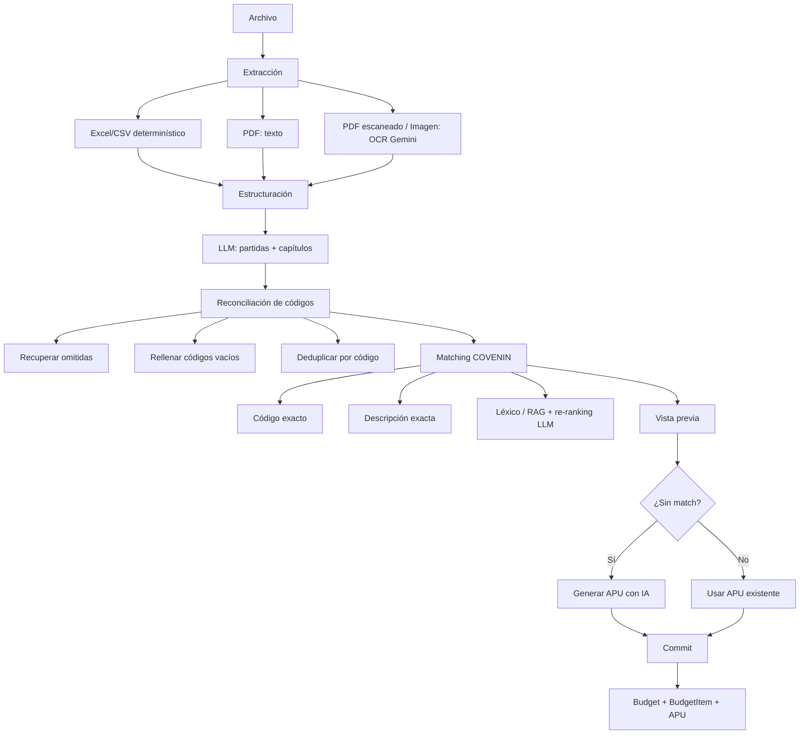

# Importación de Presupuestos desde Archivo

> **Módulo:** `budgets` / `budget_import`
> **Funcionalidad:** Crear un presupuesto completo a partir de un Excel, CSV, PDF o imagen.
> **Última actualización:** Octubre 2026
> **Estado:** Implementado y desplegado en producción (`costbase.net`)

---

## 1. ¿Qué hace?

El botón **“Crear Presupuesto desde Archivo”** de la barra lateral abre un flujo que:

1. Lee un archivo de presupuesto (Excel, CSV, PDF o imagen).
2. Extrae las partidas: código, descripción, unidad y cantidad.
3. Detecta capítulos/secciones y las separa de las partidas.
4. Cruza cada partida contra la base maestra COVENIN (`cost360_items`).
5. Propone un APU existente cuando hay coincidencia por código o descripción.
6. Permite **generar un APU con IA** para las partidas que no tengan match.
7. Crea el presupuesto y guarda las partidas con sus insumos APU.

El objetivo es que el usuario no tenga que volver a digitar un presupuesto que ya existe en un documento, y que cada partida quede con un código y un APU utilizable.

---

## 2. Flujo de usuario

### 2.1 Entrada

- Botón en la barra lateral: **Crear Presupuesto desde Archivo**, ubicado arriba de **Cálculo FCAS**.
- Abre el modal `BudgetFileImportModal`.
- Formatos aceptados:
  - Excel: `.xlsx`, `.xls` (y `.xlsm` a nivel de backend).
  - CSV: `.csv`.
  - PDF: `.pdf` (con capa de texto o escaneado).
  - Imágenes: `.png`, `.jpg`, `.jpeg`, `.webp`.
- Tamaño máximo: **25 MB**.
- El archivo se procesa en memoria; no se guarda en disco.

### 2.2 Vista previa editable

Antes de crear el presupuesto se muestra una vista previa con:

- Nombre del presupuesto, proyecto/obra, cliente y moneda (USD/VES).
- Conteos: capítulos, partidas con APU, partidas por revisar, partidas sin coincidencia.
- Por cada fila:
  - Casilla para incluir/excluir.
  - Descripción editable.
  - Unidad y cantidad editables.
  - Selector de partida COVENIN (candidatas de la base maestra).
  - Botón **Generar APU con IA** cuando la fila no tiene un match exacto.
- Advertencias del procesamiento (OCR, fragmentos, partidas recuperadas, etc.).

### 2.3 Estados de una fila

| Estado | Significado |
|---|---|
| **Match exacto** | El código o la descripción normalizada coincide exactamente con una partida de la base maestra. |
| **APU sugerido** | Hay una partida candidata seleccionada por el motor de matching/LLM. |
| **Por revisar** | Hay candidatas, pero ninguna quedó seleccionada automáticamente. |
| **Sin coincidencia** | No se encontró ninguna candidata. |
| **APU generado** | El usuario generó un APU nuevo con IA para esa fila. |
| **Capítulo** | Fila de título/sección, sin unidad ni cantidad. |

### 2.4 Generación bajo demanda

- El botón **Generar APU con IA** aparece en las filas que no tienen match exacto.
- Usa el motor de APUs de la plataforma (RAG + LLM + reglas deterministas).
- Devuelve un APU con:
  - Código de Partida Especial (convención `E###SC###`, por ejemplo `E451SC001`).
  - Materiales, equipos y mano de obra con cantidades y precios.
- La fila pasa a **APU generado** y queda seleccionada.
- Cada generación consume **1 APU de la cuota de IA** del usuario.
- Si el usuario luego elige otra partida en el selector, el APU generado deja de usarse.

### 2.5 Creación

Al pulsar **Crear presupuesto**:

- Se crea un `Budget` con los valores por defecto de costos del usuario (`costos_config`).
- Se crean los `BudgetItem` en orden.
- Para partidas con APU de la base: se copian sus insumos a las tablas `budget_apu_*`.
- Para partidas generadas: se guardan los insumos devueltos por el generador.
- Para partidas sin APU: se crea la partida genérica (sin insumos) para completarla luego.
- Al finalizar, el frontend navega a `/budgets/{id}`.

---

## 3. Arquitectura



### 3.1 Backend

| Archivo | Responsabilidad |
|---|---|
| `backend/app/api/v1/endpoints/budgets/import_file.py` | Endpoints HTTP de preview, generación y commit. |
| `backend/app/services/budget_import/extractors.py` | Lectura de Excel/CSV/PDF/imagen, detección de columnas y OCR. |
| `backend/app/services/budget_import/structuring.py` | Estructuración del texto en partidas con LLM. |
| `backend/app/services/budget_import/reconcile.py` | Reconciliación de códigos y recuperación de partidas omitidas. |
| `backend/app/services/budget_import/matching.py` | Búsqueda de candidatas COVENIN y re-ranking. |
| `backend/app/services/budget_import/ocr.py` | OCR con Gemini Vision. |
| `backend/app/services/budget_import/errors.py` | Errores de dominio del importador. |
| `backend/app/services/budget_import/__init__.py` | Orquestador `build_preview` y estadísticas. |

### 3.2 Frontend

| Archivo | Responsabilidad |
|---|---|
| `frontend/src/components/layout/AppLayout.jsx` | Botón lateral, input de archivo y apertura del modal. |
| `frontend/src/components/modals/BudgetFileImportModal.jsx` | Vista previa, edición, generación por fila y creación. |
| `frontend/src/services/budgetService.js` | Métodos `previewImport`, `generateImportApu` y `commitImport`. |

### 3.3 Endpoints

#### `POST /api/v1/budgets/import/preview`

- **Auth:** cookie `arko_admin_token` o Bearer JWT.
- **Body:** `multipart/form-data` con `file`.
- **Respuesta:**

```json
{
  "filename": "presupuesto.xlsx",
  "source_type": "excel",
  "header": {
    "budget_name": "Presupuesto de obra",
    "project_name": "Casa Habitación",
    "client_name": "Cliente",
    "currency": "USD"
  },
  "items": [
    {
      "row": 1,
      "code": "18.A.01",
      "description": "Remoción de impermeabilización existente...",
      "unit": "m2",
      "quantity": 830.0,
      "is_chapter": false,
      "candidates": [
        {
          "cod_par": "E451SC001",
          "cov_par": "E451...",
          "description": "IMPERMEABILIZACIÓN...",
          "unit": "m2",
          "score": 0.87,
          "match_type": "description"
        }
      ],
      "selected_cod_par": "E451SC001"
    }
  ],
  "stats": {
    "total": 10,
    "matched": 8,
    "selected": 6,
    "pending": 2,
    "generic": 0,
    "chapters": 2
  },
  "warnings": []
}
```

#### `POST /api/v1/budgets/import/generate-apu`

Genera un APU con el motor de la plataforma para una fila.

- **Body:**

```json
{
  "description": "Aplicación de imprimación asfáltica...",
  "unit": "m2",
  "code": "18.A.04"
}
```

- **Respuesta:**

```json
{
  "status": "completed",
  "partida": {
    "cod_par": "E451SC001",
    "description": "APLICACIÓN DE IMPRIMACIÓN ASFÁLTICA...",
    "unit": "m2",
    "quantity": 1.0,
    "performance": 40.0
  },
  "materials": [],
  "equipments": [],
  "labors": [],
  "advertencias": []
}
```

- Requiere `check_ai_access`.
- Incrementa `ai_apus_generated` en `arko_admins` al completar.
- Si no hay proveedor LLM o falla, responde `502`.
- Si el APU no contiene insumos, responde `422`.

#### `POST /api/v1/budgets/import/commit`

- **Body:**

```json
{
  "name": "Presupuesto importado",
  "project_name": "Obra",
  "client_name": "Cliente",
  "currency": "USD",
  "source_filename": "presupuesto.pdf",
  "items": [
    {
      "description": "...",
      "unit": "m2",
      "quantity": 830.0,
      "is_chapter": false,
      "cod_par": "E451SC001",
      "cov_par": "E451...",
      "code": "18.A.04",
      "materials": [],
      "equipments": [],
      "labors": []
    }
  ]
}
```

- `materials`, `equipments` y `labors` solo se envían para partidas generadas con IA.
- Para partidas existentes, el backend copia los insumos desde `cost360_items`.
- **Respuesta:**

```json
{
  "budget_id": "uuid",
  "items_created": 10,
  "matched_items": 6,
  "generated_items": 2,
  "generic_items": 2,
  "message": "Presupuesto creado con 10 partidas (...)"
}
```

---

## 4. Procesamiento del archivo

### 4.1 Excel y CSV

- Lectura con `pandas` (`openpyxl` para `.xlsx`, `xlrd` para `.xls`).
- Hasta **12 hojas** y **800 filas** por hoja.
- Detección de encabezado en las primeras 40 filas, con alias para:
  - Descripción: `descripción`, `concepto`, `detalle`, `actividad`, `rubro`, etc.
  - Código: `código`, `cod`, `covpar`, `codpar`, `item`, `partida`, etc.
  - Unidad: `unidad`, `und`, `un`, `um`, etc.
  - Cantidad: `cantidad`, `cant`, `metrado`, `metraje`, etc.
- Normaliza unidades y cantidades venezolanas (`25,50` → `25.5`, `1.234,56` → `1234.56`).
- Detecta capítulos por título, ausencia de unidad/cantidad o formato de sección.
- Si no encuentra una tabla clara, vuelca el contenido a texto y usa el LLM como respaldo.

### 4.2 PDF

- Extracción de texto con PyMuPDF (`get_text` ordenado).
- Hasta **20 páginas** de texto.
- Si el PDF no tiene capa de texto (escaneado), renderiza hasta **8 páginas** y aplica OCR.
- El texto se trunca a 60,000 caracteres.

### 4.3 Imágenes

- Se abre con Pillow, se corrige orientación EXIF y se reduce a un máximo de 2400 px.
- OCR con Gemini Vision, en lotes de hasta 5 imágenes por llamada.

### 4.4 Estructuración con LLM

- El texto se divide en fragmentos de hasta **9,000 caracteres** (máximo 8 fragmentos).
- El prompt exige un JSON con:
  - `budget_name`, `project_name`, `client_name`, `currency`.
  - `items[]` con `codigo`, `descripcion`, `unidad`, `cantidad`, `is_chapter`.
- Reglas:
  - Ignorar totales, subtotales, IVA, encabezados, pies, firmas.
  - Una fila de tabla = una partida.
  - Capítulos con `is_chapter: true`.
  - No inventar partidas.
  - Cantidades con coma decimal venezolana.
- Se deduplican partidas por código (o por descripción/unidad/cantidad si no hay código).

---

## 5. Reconciliación de códigos

La IA puede omitir filas en documentos largos. `reconcile.py` corrige eso:

1. Extrae del texto original todos los códigos de partida (`18.A.01`, `E.311.100.000`, etc.) y sus bloques de texto.
2. Rellena códigos vacíos:
   - Por secuencia (`18.M.05` y `18.M.07` → `18.M.06`).
   - Por similitud de descripción con el bloque del código faltante.
3. Detecta códigos esperados que no aparecieron en la respuesta del LLM.
4. Los recupera con una llamada puntual al LLM y, si falla, con un parser determinista del bloque.
5. Inserta cada partida recuperada en su posición correcta.
6. Deduplica por código, no por descripción.

Esto evita dos problemas típicos:

- Que una partida repetida en otra sección se elimine por tener la misma descripción.
- Que el conteo final quede por debajo del documento real.

---

## 6. Matching COVENIN

### 6.1 Orden de prioridad

1. **Código exacto:** se normaliza el código del archivo (sin puntos, guiones ni espacios) y se compara con `CovPar` y `CodPar`.
2. **Descripción exacta:** se normaliza la descripción (sin tildes, signos ni espacios repetidos) y se compara con `Descri`.
3. **Búsqueda léxica/RAG:** se recuperan hasta 8 candidatas.
4. **Re-ranking con LLM:** se envían las candidatas al LLM para elegir la mejor por acción, elemento, material, dimensiones y unidad.

### 6.2 Reglas y señales

- Se prioriza la unidad compatible.
- Se penalizan demoliciones/remociones cuando la partida pide construir o instalar.
- Se penalizan filas de carga/transporte cuando no se pidió acarreo.
- Se suma coincidencia de tokens técnicos.
- Las partidas con `CovPar` codificado tienen una pequeña bonificación.
- Las coincidencias exactas (código o descripción) **no pasan por el re-ranking** y se seleccionan directamente.

### 6.3 Estadísticas

| Campo | Significado |
|---|---|
| `total` | Filas totales (incluye capítulos). |
| `matched` | Partidas con al menos una candidata. |
| `selected` | Partidas con una candidata seleccionada por defecto. |
| `pending` | Con candidatas, pero sin selección (por revisar). |
| `generic` | Sin candidatas. |
| `chapters` | Títulos de capítulo. |

### 6.4 Nota sobre producción

En la imagen actual de producción se desinstala `sentence-transformers`, por lo que el motor semántico no está cargado. El matching usa la búsqueda léxica IDF + re-ranking con LLM. Si se restauran los embeddings, el matching semántico mejora la recuperación de candidatas.

---

## 7. Generación de APUs con IA

### 7.1 Motor utilizado

La generación **no** usa un servicio externo de APUs. Usa el motor propio de la plataforma:

1. `preprocess_apu_data` (`backend/app/services/preprocessing_service.py`):
   - Busca partidas similares en `cost360_items`.
   - Recupera rendimientos, insumos y precios históricos.
   - Construye el contexto para el LLM.
2. `generate_apu_with_ai` (`backend/app/services/ai_apu_service/generator/free_generator.py`):
   - Arma el prompt y llama al LLM.
   - Aplica reglas COVENIN, calibración de cuadrillas, reconciliación de materiales y salvaguardas deterministas.
   - Devuelve `partida`, `materials`, `equipments`, `labors` y `advertencias`.
3. `llm_router.py`:
   - Envía la inferencia a los proveedores configurados en `llm_providers`.
   - En producción: **DeepSeek** como primario y **Gemini** como respaldo.

### 7.2 Código de la partida generada

- El generador usa la convención de **Partida Especial**:
  - `E451SC001` para impermeabilizaciones.
  - `E411SC001` para albañilería.
  - `E511SC001` para instalaciones hidráulicas.
  - etc.
- Son códigos `SC` (sin código oficial COVENIN), no códigos tipificados del tabulador.
- Si la partida se resuelve con una partida existente, se usa su `CovPar` real.

### 7.3 Cuotas y permisos

- Requiere `has_ai_access` o ser superadmin.
- Cada generación consume 1 APU de la cuota mensual (`ai_apus_generated`).
- Si el plan no tiene acceso a IA: `403`.
- Si se agota la cuota: `403`.
- Si no hay proveedor LLM o todos fallan: `502`.
- Si el APU sale sin insumos: `422`.

### 7.4 Persistencia

- Los insumos generados se guardan en el presupuesto (`budget_apu_materials`, `budget_apu_equipments`, `budget_apu_labors`).
- **No se guardan automáticamente** en `cost360_custom_items` (Base Personalizada). Es una mejora pendiente para reutilizar el APU en futuras partidas.

---

## 8. Modelo de datos

### 8.1 `Budget`

Campos relevantes:

- `name`, `description`, `project_name`, `client_name`, `currency`.
- `fcas_percent`, `admin_percent`, `profit_percent`, `iva_percent`, `labor_bonus`.
- `material_inflation`, `labor_inflation`, `equipment_inflation`.

Los porcentajes se inicializan con `costos_config` del usuario.

### 8.2 `BudgetItem`

| Campo | Importado desde |
|---|---|
| `cod_par` | Código de la partida de la base, código generado o `IMP-###`/`GEN-###`. |
| `cov_par` | `CovPar` de la partida existente o código generado. |
| `description` | Descripción del archivo (editable en la vista previa). |
| `unit` | Unidad de la base si hay match; unidad del archivo si es genérica/generada. |
| `quantity` | Cantidad del archivo. |
| `performance` | `1.0` por defecto. |
| `order` | Orden de la fila. |
| `is_chapter` | `true` para capítulos. |

### 8.3 Insumos

- `BudgetAPUMaterial`: código, descripción, unidad, precio, cantidad, desperdicio.
- `BudgetAPUEquipment`: código, descripción, unidad, precio, cantidad, depreciación.
- `BudgetAPULabor`: código, descripción, cantidad, jornal, bono.

---

## 9. Límites y validaciones

| Límite | Valor |
|---|---|
| Tamaño de archivo | 25 MB |
| Partidas por importación | 300 |
| Hojas de Excel | 12 |
| Filas por hoja | 800 |
| Páginas de PDF con texto | 20 |
| Páginas de PDF escaneado con OCR | 8 |
| Imágenes por llamada de OCR | 5 |
| Caracteres por fragmento de estructuración | 9,000 |
| Fragmentos máximos | 8 |
| Partidas refinadas por LLM | 4 lotes × 40 = 160 |
| Candidatas recuperadas | 8 |
| Candidatas mostradas | 5 |
| Descripción por partida | 600 caracteres |
| Código por partida | 80 caracteres |
| Unidad | 20 caracteres |

Validaciones adicionales:

- El archivo debe tener extensión soportada.
- El archivo no puede estar vacío.
- El presupuesto debe tener al menos una partida incluida.
- Se valida el límite de presupuestos y de partidas por presupuesto del plan.
- Se valida el acceso a IA antes de generar.

---

## 10. Seguridad

- Autenticación mediante cookie httpOnly `arko_admin_token` o Bearer JWT.
- El archivo se procesa en memoria; no se escribe en disco.
- Se valida extensión y tamaño antes de procesar.
- No se ejecuta contenido del archivo.
- El LLM solo extrae/estructura datos; no ejecuta herramientas.
- Aun así, un documento malicioso podría intentar inyectar instrucciones en el prompt. Las respuestas se validan y normalizan, y el usuario revisa la vista previa antes de crear el presupuesto.
- Las descripciones y el contexto se envían a los proveedores LLM configurados; no subir documentos sensibles sin autorización.

---

## 11. Despliegue

### 11.1 Backend

- La imagen base ya incluye `pandas`, `PyMuPDF` y `Pillow`.
- El `Dockerfile` instala `xlrd==2.0.1` para leer `.xls`.
- Los endpoints se registran en `backend/app/api/v1/endpoints/budgets/__init__.py`.

### 11.2 Frontend

- El botón y el modal se incluyen en el bundle de Vite.
- El input acepta `.xlsx`, `.xls`, `.csv`, `.pdf`, `.png`, `.jpg`, `.jpeg`, `.webp`.

### 11.3 Nginx

El bloque de `costbase.net` debe permitir subidas de 25 MB:

```nginx
client_max_body_size 25M;
```

Sin esto, Nginx responde `413` antes de llegar al backend.

### 11.4 CI/CD

- `git push` a `main` dispara GitHub Actions.
- Se construyen y publican las imágenes de backend y frontend.
- El job de deploy entra por SSH al servidor, hace `git pull`, `docker compose pull` y `docker compose up -d`.
- El repositorio del servidor debe estar limpio (sin cambios locales que impidan el `git pull`).

---

## 12. Verificación realizada

### 12.1 Archivos de prueba

- Excel con capítulos, partidas y cantidades con coma decimal.
- CSV con separador `;`.
- PDF con capa de texto.
- Imagen PNG con tabla de presupuesto.

### 12.2 Resultado con el PDF real de Higuerote

Archivo: `Levantamiento_Bomberos_Aeronauticos_Higuerote.pdf`

- 11 páginas.
- 17 secciones (`18.A` a `18.Q`).
- 124 partidas reales.
- Resultado del importador:
  - **141 filas** = 17 capítulos + 124 partidas.
  - **0 faltantes**.
  - **0 duplicados**.
  - 85 con APU, 37 por revisar, 2 sin coincidencia (al momento de la prueba).

Partidas recuperadas por reconciliación: `18.C.09`, `18.C.10`, `18.K.01`.
Partida con código vacío corregida: `18.M.06`.

> Nota: el documento no tiene 9 partidas. Las 9 partidas son solo la sección `18.A` (Impermeabilización de cubiertas).

### 12.3 Generación de APU

Prueba con la partida “Aplicación de imprimación asfáltica o primer compatible…”:

- Código generado: `E451SC001`.
- 1 material, 1 equipo, 3 mano de obra.
- Presupuesto creado con esos componentes (`201 Created`).
- Verificación en base de datos: componentes persistidos correctamente.
- Presupuesto de prueba eliminado después.

### 12.4 Flujo público

- El bundle servido en `costbase.net` contiene el modal y el botón de generación.
- El endpoint de preview responde `200` a través de Nginx.
- Una subida de 2 MB pasa Nginx (responde `422` por formato no soportado, no `413`).

---

## 13. Limitaciones conocidas

1. **No hay selector de páginas/secciones.** Si un PDF contiene varias secciones y solo se necesita una, se importan todas. Se puede agregar un filtro por sección/página.
2. **El match exacto de descripción es estricto.** Muchas descripciones del archivo no coinciden literalmente con la base; en esos casos se usan candidatas y el usuario revisa o genera.
3. **La generación es bajo demanda y secuencial.** Cada APU tarda varios segundos (≈5–10 s). No hay generación masiva en segundo plano.
4. **Los APUs generados no se guardan en la Base Personalizada.** Solo quedan dentro del presupuesto.
5. **Los APUs generados usan códigos `SC`**, no códigos COVENIN oficiales.
6. **Sin embeddings semánticos en producción.** El matching usa léxico + LLM.
7. **Documentos muy largos se truncan** (20 páginas de PDF, 8 de OCR, 60,000 caracteres, 300 partidas).
8. **El refinamiento con LLM cubre hasta 160 partidas**; el resto conserva el orden heurístico.

---

## 14. Solución de problemas

| Síntoma | Causa probable | Solución |
|---|---|---|
| `413 Request Entity Too Large` | Nginx sin `client_max_body_size`. | Agregar `client_max_body_size 25M;` y recargar Nginx. |
| `422 Formato no soportado` | Extensión no permitida. | Usar `.xlsx`, `.xls`, `.csv`, `.pdf`, `.png`, `.jpg`, `.jpeg` o `.webp`. |
| `422 No se pudieron identificar partidas` | PDF/imagen ilegible o sin tabla. | Mejorar calidad de imagen, usar PDF con texto o revisar el documento. |
| `503` en OCR | No hay proveedor Gemini activo. | Configurar Gemini en `/admin/llm-providers`. |
| `502` al generar APU | Todos los proveedores LLM fallaron. | Revisar cuotas/API keys de DeepSeek/Gemini. |
| `403` al generar APU | Sin acceso a IA o cuota agotada. | Actualizar plan o revisar `has_ai_access` / `max_ai_apus`. |
| `403` al crear presupuesto | Límite de presupuestos o partidas del plan. | Ajustar plan o reducir partidas. |
| Faltan partidas | El LLM las omitió y la reconciliación no las detectó. | Revisar códigos del documento y logs de `reconcile.py`. |
| Se duplican partidas | El documento repite códigos o descripciones. | La deduplicación es por código; revisar el archivo. |

---

## 15. Mantenimiento

### 15.1 Agregar un formato nuevo

1. Añadir la extensión en `extractors.py` (`EXCEL_EXTENSIONS`, `PDF_EXTENSIONS`, etc.).
2. Implementar el extractor correspondiente.
3. Añadir la extensión al `accept` del input en `AppLayout.jsx` y `BudgetFileImportModal.jsx`.
4. Probar con un archivo real.

### 15.2 Ajustar la estructuración

- Tamaño de fragmento: `MAX_CHUNK_CHARS` en `structuring.py`.
- Máximo de fragmentos: `MAX_CHUNKS`.
- Prompt: `_build_prompt`.
- Esquema: `_ITEM_SCHEMA`.

### 15.3 Ajustar el matching

- Candidatas recuperadas/mostradas: `MAX_CANDIDATES` y `limit` en `matching.py`.
- Re-ranking: `_REFINE_BATCH_SIZE`, `_MAX_REFINE_BATCHES`.
- Umbrales de similitud y penalizaciones: `find_candidates`.
- Coincidencia exacta: `_normalize_header` y `_normalize_code`.

### 15.4 Ajustar la generación

- Prompt y reglas COVENIN: `backend/app/services/ai_apu_service/prompts.py`.
- Flujo del generador: `backend/app/services/ai_apu_service/generator/free_generator.py`.
- Preprocesamiento/RAG: `backend/app/services/preprocessing_service.py`.
- Proveedores LLM: `/admin/llm-providers` (`llm_providers`).

### 15.5 Cambiar el límite de subida

1. `MAX_FILE_BYTES` en `import_file.py`.
2. `client_max_body_size` en Nginx.
3. `accept` del frontend si cambia el tipo de archivo.

---

## 16. Historial

| Fecha | Cambio |
|---|---|
| Octubre 2026 | Implementación inicial del botón y modal. |
| Octubre 2026 | Soporte de Excel, CSV, PDF e imágenes con OCR. |
| Octubre 2026 | Reconciliación de códigos y recuperación de partidas omitidas. |
| Octubre 2026 | Matching exacto por código/descripción + re-ranking. |
| Octubre 2026 | Generación de APUs con IA bajo demanda por partida. |
| Octubre 2026 | Corrección del `NameError` de `ai_apu_service_v2` que afectó el arranque del backend. |

Commits relevantes:

- `ef678ab` — funcionalidad base.
- `0e5e05f` — instalación de `xlrd` para `.xls`.
- `07318da` — generación de APUs bajo demanda.
- `493a121` — corrección del motor v2 y limpieza de caché de build.

---

## 17. Próximos pasos sugeridos

1. Guardar los APUs generados en `cost360_custom_items` para reutilizarlos.
2. Selector de secciones/páginas para importar solo una parte del documento.
3. Búsqueda manual de COVENIN por código dentro de la vista previa.
4. Generación masiva en segundo plano con progreso y reintentos.
5. Restaurar embeddings semánticos para mejorar el matching.
6. Tests automatizados de extractores, reconciliación y matching con archivos de muestra.
