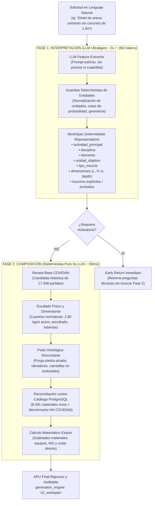

# Motor v2.0: Arquitectura de Generación en Dos Fases (WorkSpec + Compositor Determinista)

> **Módulo:** `backend/app/services/ai_apu_service_v2/`  
> **Interfaz Frontend:** `frontend/src/modules/costbase/components/ai-generator/ArchitectureModeSelector.jsx`  
> **Patrón Arquitectónico:** Compilador con Representación Intermedia (*Intermediate Representation - IR*)  
> **Normativa de Referencia:** COVENIN 2000:1992 (Sector Construcción Venezuela)  
> **Fecha de Implementación:** Octubre 2026  
> **Estado:** En producción experimental, controlado por selector de arquitectura (Feature Toggle).

---

## 1. Motivación y Diagnóstico del Audit Técnico

Durante la auditoría técnica profunda del **Motor v1.0 (Modo Adaptativo Clásico)**, se identificó la paradoja central del flujo monolítico tradicional:

```text
Flujo v1.0 (Monolítico):
Texto Libre ──> [LLM Pesado (DeepSeek/Gemini)] ──> APU Completo Alucinado ──> [~20 Salvaguardas Regex] ──> APU Final
                                                    (precios, cuadrillas,      (deshacen y corrigen
                                                     materiales inventados)     el 60% del trabajo)
```

### Problemas Críticos del Enfoque v1.0:
1. **Petición inadecuada al modelo probabilístico:** Se le pedía al LLM exactamente lo que peor hace: recordar códigos de 8.491 materiales de base de datos, inventar precios unitarios en USD y calcular rendimientos en segundos.
2. **Latencia y costo excesivos:** Generar un JSON de 200 líneas consume entre **3.000 y 5.000 tokens de salida** con una latencia de **15 a 25 segundos**.
3. **Fragilidad de mantenimiento:** Se requerían ~20 funciones deterministas posteriores para podar agregados gruesos, inyectar acero omitido, recalcular rendimientos y sobrescribir precios.
4. **Caché semántico riesgoso:** Almacenar el APU final congelaba precios que quedaban obsoletos cuando la tarifa del catálogo cambiaba.

---

## 2. Principio y Flujograma del Motor v2.0

El Motor v2.0 desacopla tajantemente la **interpretación del lenguaje natural** de la **composición matemática del APU**:



---

## 3. Especificación del Contrato `WorkSpec` (`schemas.py`)

El archivo [`backend/app/services/ai_apu_service_v2/schemas.py`](file:///c:/Users/pablo/Documents/apupro_platform/backend/app/services/ai_apu_service_v2/schemas.py) define el contrato estricto de ingeniería mediante Pydantic:

```python
class WorkSpecDimensions(BaseModel):
    length_m: Optional[float] = None          # Longitud lineal (dintel, tubería)
    width_m: Optional[float] = None           # Ancho o base
    height_m: Optional[float] = None          # Altura o espesor
    depth_m: Optional[float] = None           # Profundidad (pozos, zanjas)
    diameter_inches: Optional[float] = None   # Diámetro nominal (2", 4", etc.)
    area_m2: Optional[float] = None           # Área superficial
    volume_m3: Optional[float] = None         # Volumen geométrico

class WorkSpec(BaseModel):
    activity_type: Literal[
        "CONSTRUCCION", "INSTALACION", "VACIADO", "DEMOLICION",
        "DESMONTAJE", "REPARACION", "MANTENIMIENTO", "SUMINISTRO_E_INSTALACION", "OTRO"
    ]
    discipline: Literal[
        "EDIFICACIONES", "OBRAS_CIVILES", "HIDROSANITARIA",
        "ELECTRICA", "VIALIDAD", "MECANICA", "ACABADOS", "OTRO"
    ]
    element: Optional[str]                   # "DINTEL", "MACHON", "TUBERIA", "POZO_PROFUNDO"
    target_unit: str                         # "m", "m2", "m3", "und", "pza", "kg", "pto"
    mix_type: Literal[
        "CONCRETO_ESTRUCTURAL", "MORTERO_ARENA_CEMENTO", "PASTA_YESO", "ASFALTO", "NINGUNA"
    ]
    mounting_condition: Literal[
        "EMBUTIDA", "ENTERRADA", "SUPERFICIAL_COLGANTE", "A_LA_VISTA", "NO_APLICA"
    ]
    substrate: Optional[str]                 # "LOSA_DE_CONCRETO", "PARED_DE_BLOQUE"
    dimensions: WorkSpecDimensions
    explicit_materials: List[str]
    excluded_materials: List[str]
    manual_mixing: bool
    work_at_height: bool
    execution_days: Optional[float]
    clarification_needed: bool
    clarification_reason: Optional[str]
    clarification_options: List[str]
    technical_assumptions: List[str]
```

---

## 4. Fase 1: Extractor Semántico (`interpreter.py`)

El archivo [`backend/app/services/ai_apu_service_v2/interpreter.py`](file:///c:/Users/pablo/Documents/apupro_platform/backend/app/services/ai_apu_service_v2/interpreter.py) implementa:

1. **System Prompt Especializado:** Instruye al modelo a actuar como un extractor de entidades de ingeniería. Prohíbe inventar precios, partidas o cuadrillas.
2. **Fallback Heurístico Fail-Fast:** Si la API del LLM experimenta timeout o caída, un analizador léxico en memoria genera un `WorkSpec` canónico sin arrojar error 500 al cliente.
3. **Guardias Deterministas de Refuerzo (`_apply_deterministic_overrides`):**
   * Normalización de unidades: `pza` / `unid` $\rightarrow$ `und`.
   * Negaciones en mezclas: Detecta `"sin concreto"` o `"sin piedra picada"` forzando `mix_type = "MORTERO_ARENA_CEMENTO"` y agregando `"PIEDRA_PICADA"` a `excluded_materials`.
   * Detección de pozos profundos: Extrae cota de profundidad válida (10m a 400m) mediante [`extract_depth`](file:///c:/Users/pablo/Documents/apupro_platform/backend/app/services/ai_apu_service/domain_rules/deep_well.py#L11).
   * Geometría lineal y discreta: Sincroniza longitudes y volúmenes calculados.

---

## 5. Fase 2: Compositor Determinista (`composer.py`)

El archivo [`backend/app/services/ai_apu_service_v2/composer.py`](file:///c:/Users/pablo/Documents/apupro_platform/backend/app/services/ai_apu_service_v2/composer.py) realiza el ensamblaje sin LLMs:

1. **Resolución de la Receta Base:** Si existe una partida base COVENIN histórica seleccionada (de las 17.408 partidas), la clona profundamente como plantilla madre.
2. **Preservación de Sustratos en Descripción:** Si la solicitud es de mortero pero interviene sobre una losa base (ej. *"sobre losa de concreto"*), la regla preserva la mención a la losa y solo renombra el vaciado principal a *"MORTERO"*.
3. **Inyección Estructural Determinista:**
   * En elementos a flexión (`DINTEL`, `MACHON`, `VIGA_CORONA`), calcula e inyecta:
     * Cabilla corrugada de $3/8"$: $2.80 \text{ kg/m} \times L$.
     * Alambre negro #18: $0.06 \text{ kg/m} \times L$.
     * Encofrado de madera: $0.55 \text{ m}^2/\text{m} \times L$.
     * Clavos para encofrado: $0.06 \text{ kg/m} \times L$.
4. **Poda Ontológica de Insumos Discordantes:**
   * Purga agregados gruesos y vibradores si la mezcla es mortero.
   * Purga carretillas y cintas topográficas si la instalación de tubería es embutida en pared.
   * Purga andamios y pistolas de fijación si la tubería es enterrada en zanja.
5. **Reconciliación y Calibración Oficial:**
   * Materiales y equipos conciliados con el catálogo de PostgreSQL (`cost360_materials`).
   * Cuadrilla y rendimiento ajustados por el calibrador canónico de horas-hombre COVENIN ([`calibrate_apu_crew_and_equipment`](file:///c:/Users/pablo/Documents/apupro_platform/backend/app/services/apu_labor_calibrator.py)).
6. **Cálculo Matemático de Subtotales:**
   * Sumatoria exacta: $\text{Materiales} + \text{Equipos} + \text{Mano de Obra} = \text{Costo Directo}$.

---

## 6. Integración en API y Selector en Frontend

### 6.1 Backend Dispatcher (`ai_generation.py`)
En [`backend/app/api/v1/endpoints/costbase/ai_generation.py`](file:///c:/Users/pablo/Documents/apupro_platform/backend/app/api/v1/endpoints/costbase/ai_generation.py#L500):
```python
if payload.generation_mode in ("v2", "workspec") and is_superadmin and not payload.only_preprocess:
    # Si no se envió partida base manual, se busca la mejor candidata COVENIN
    if not base_code:
        v2_candidates, _ = get_dynamic_candidates(db, payload.description, limit=5)
        if v2_candidates and v2_candidates[0]["score"] >= 0.35:
            base_code = v2_candidates[0]["item"].CodPar
    if base_code:
        base_apu = fetch_base_apu_for_prompt(db, base_code)

    return generate_apu_v2(
        user_description=payload.description,
        requested_unit=effective_unit or payload.unit,
        covenin_prefix=payload.covenin_prefix,
        context=payload.covenin_context,
        base_apu=base_apu,
        db=db
    )
```

### 6.2 Frontend Selector (`ArchitectureModeSelector.jsx`)
En [`frontend/src/modules/costbase/components/ai-generator/ArchitectureModeSelector.jsx`](file:///c:/Users/pablo/Documents/apupro_platform/frontend/src/modules/costbase/components/ai-generator/ArchitectureModeSelector.jsx):
* Selector visual de 3 modos:
  1. **Modo Matemático:** Síntesis inversa component-first.
  2. **Modo Adaptativo (v1):** Generación monolítica clásica con salvaguardas (Default).
  3. **Motor v2.0 (WorkSpec):** Generación tipada en dos fases (Nuevo).
* Ubicado en:
  * La cabecera superior principal de la pantalla ([`ApuGeneratorHeader.jsx`](file:///c:/Users/pablo/Documents/apupro_platform/frontend/src/modules/costbase/components/ai-generator/ApuGeneratorHeader.jsx)).
  * El asistente guiado chatbot ([`GuidedAssistantModal.jsx`](file:///c:/Users/pablo/Documents/apupro_platform/frontend/src/modules/costbase/components/ai-generator/GuidedAssistantModal.jsx)).

---

## 7. Tabla Comparativa: Motor v1.0 vs Motor v2.0

| Dimensión | Motor v1.0 (Modo Adaptativo Clásico) | Motor v2.0 (WorkSpec + Compositor) |
|---|---|---|
| **Latencia Total** | 15 a 25 segundos | **1.5 a 3.0 segundos** (reducción del 85%) |
| **Consumo de Tokens** | 3.500 a 5.000 tokens por APU | **300 a 500 tokens** (reducción del 90%) |
| **Generación de Precios** | El LLM genera precios inventados | **El LLM nunca genera precios** (100% catálogo BD / web acotada) |
| **Rendimiento Diario** | Propenso a alucinación del LLM ($50\text{ und}$ o $0.01\text{ und}$) | **100% canónico COVENIN** derivado de horas-hombre y geometría |
| **Refuerzo en Dinteles/Machones** | Frecuentemente omitido por el LLM en unidades `und` | **Inyección matemática obligatoria** ($2.80\text{ kg/m}$ acero + encofrado) |
| **Poda de Insumos Discordantes** | Requiere ~20 capas de regex cruzadas | **Poda directa por atributos tipados** (`mounting_condition`, `mix_type`) |
| **Caché Semántico** | Almacena el APU final (riesgo de precios obsoletos) | **Cachea `Prompt → WorkSpec`**; el APU siempre usa precios del día |
| **Riesgo en Producción** | Sistema activo en producción | **Cero riesgo**; convive mediante feature flag para superadmin |

---

## 8. Batería de Pruebas Automatizadas

El motor v2.0 cuenta con su suite de validación unitaria e integración:

* **Suite Motor v2.0:** [`scratch/test_v2_engine.py`](file:///c:/Users/pablo/Documents/apupro_platform/scratch/test_v2_engine.py)
  * `test_workspec_schema_and_defaults`: Validación del modelo Pydantic y serialización.
  * `test_phase1_deterministic_overrides`: Pruebas de mortero, pozo profundo y longitud lineal.
  * `test_phase2_subtotals_calculation`: Precisión matemática de subtotales y costos directos.
  * `test_phase2_composer_structural_enforcement`: Inyección de acero y purga de agregados gruesos.
  * `test_v2_end_to_end_clarification`: Retorno temprano ante aclaratorias sin ejecutar Fase 2.
  * **Resultado:** `5/5 PASSED (100%)`.

* **Suite de Regresión Global v1.0:** [`scratch/test_audit_remediation.py`](file:///c:/Users/pablo/Documents/apupro_platform/scratch/test_audit_remediation.py)
  * Valida que las 16 reglas blindadas de la plataforma v1 continúen funcionando al 100%.
  * **Resultado:** `16/16 PASSED (100%)`.
