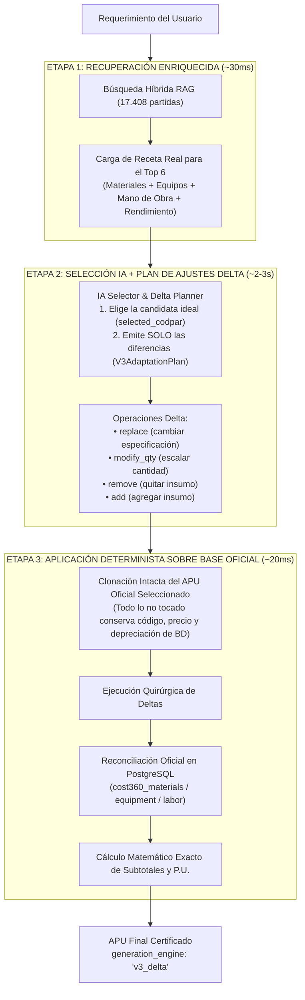

# Motor v3.0: Selección IA de Mejor Partida Base + Ajustes Puntuales (Delta Patching)

> **Módulo:** `backend/app/services/ai_apu_service_v3/`  
> **Interfaz Frontend:** `frontend/src/modules/costbase/components/ai-generator/ArchitectureModeSelector.jsx`  
> **Patrón Arquitectónico:** *Enriched Candidate Inspection + Best-Match Selection + Surgical Delta Patching*  
> **Normativa de Referencia:** COVENIN 2000:1992 (Sector Construcción Venezuela)  
> **Fecha de Implementación:** 24 de Octubre 2026  

---

## 1. Principio Central del Motor v3.0

El **Motor v3.0** replica exactamente el proceso mental de un ingeniero de costos experto frente a un catálogo de 17.408 partidas oficiales:

1. **Inspeccionar las mejores candidatas viendo sus insumos reales:**
   En lugar de tomar a ciegas `candidates[0]` por puntaje léxico/vectorial, el sistema recupera las **Top 6 partidas candidatas** desde PostgreSQL junto con su receta completa (materiales, equipos, mano de obra y rendimiento diario).
2. **Elegir el mejor molde constructivo y definir SOLO la lista de cambios (*Delta*):**
   La IA compara el requerimiento del usuario contra las 6 recetas reales, escoge cuál partida es el molde más fiel (`selected_codpar`) y emite **únicamente una lista de operaciones puntuales** (`replace`, `modify_qty`, `remove`, `add`) para transformar esa partida base en lo solicitado.
3. **Preservar intacto el 100% de lo que no requiere cambio:**
   El aplicador determinista clona la partida oficial elegida directamente de la base de datos (conservando códigos oficiales, precios de catálogo, depreciaciones reales de equipos, jornales y rendimiento COVENIN) y ejecuta únicamente los ajustes Delta solicitados, reconciliando cualquier insumo nuevo o reemplazado contra `cost360_materials`, `cost360_equipment` y `cost360_labor`.

---

## 2. Flujograma del Motor v3.0

---

## 3. Estructura del Paquete (`backend/app/services/ai_apu_service_v3/`)

* [`schemas.py`](file:///c:/Users/pablo/Documents/apupro_platform/backend/app/services/ai_apu_service_v3/schemas.py): Contratos Pydantic (`V3AdaptationPlan`, `V3MaterialDeltaOp`, `V3EquipmentDeltaOp`, `V3LaborDeltaOp`, `V3GenerationMeta`).
* [`selector_planner.py`](file:///c:/Users/pablo/Documents/apupro_platform/backend/app/services/ai_apu_service_v3/selector_planner.py): Recuperación de candidatas enriquecidas con sus recetas reales (`fetch_enriched_candidates_for_v3`) y planificador de selección + deltas (`plan_v3_selection_and_deltas`).
* [`delta_applier.py`](file:///c:/Users/pablo/Documents/apupro_platform/backend/app/services/ai_apu_service_v3/delta_applier.py): Aplicador quirúrgico de operaciones Delta sobre el APU oficial (`apply_v3_deltas_to_base_apu`) y reconciliación contra catálogo vivo.
* [`service.py`](file:///c:/Users/pablo/Documents/apupro_platform/backend/app/services/ai_apu_service_v3/service.py): Orquestador principal (`generate_apu_v3`) con telemetría y trazabilidad completa para el archivo de diagnóstico `debug_apu_*.json`.
